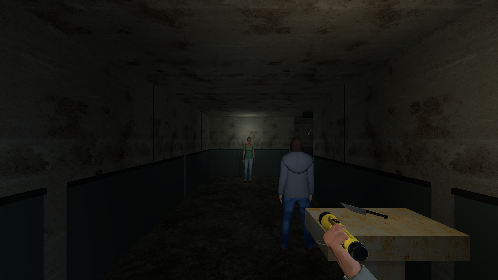
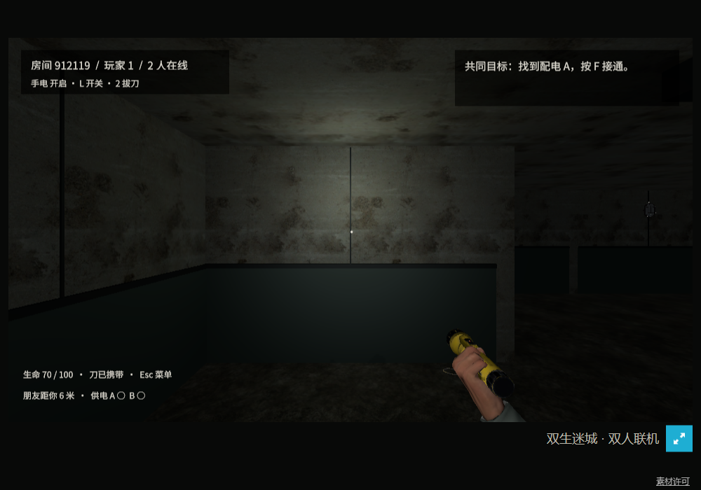
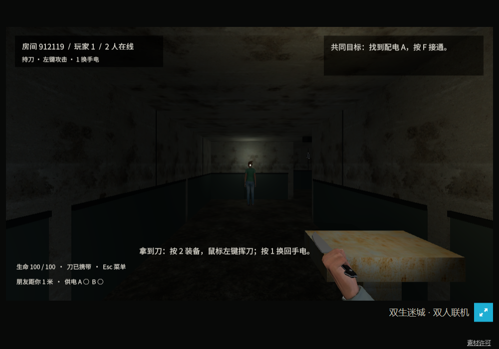
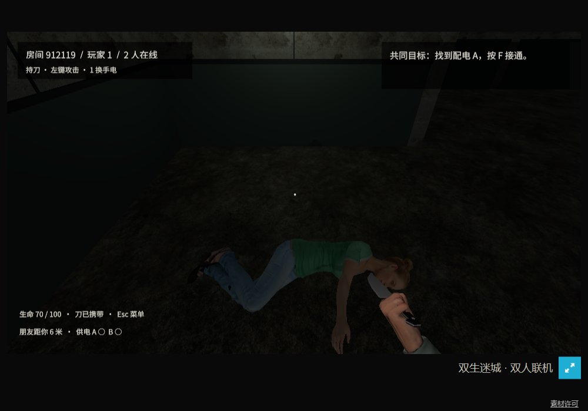
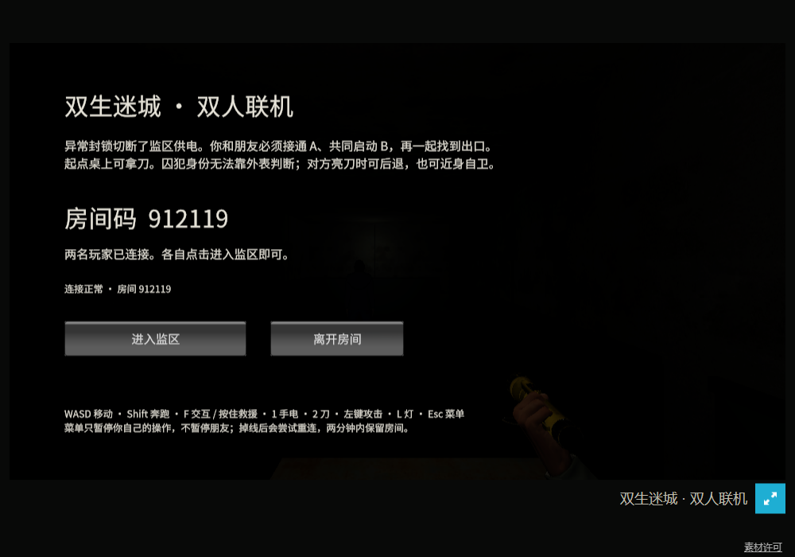
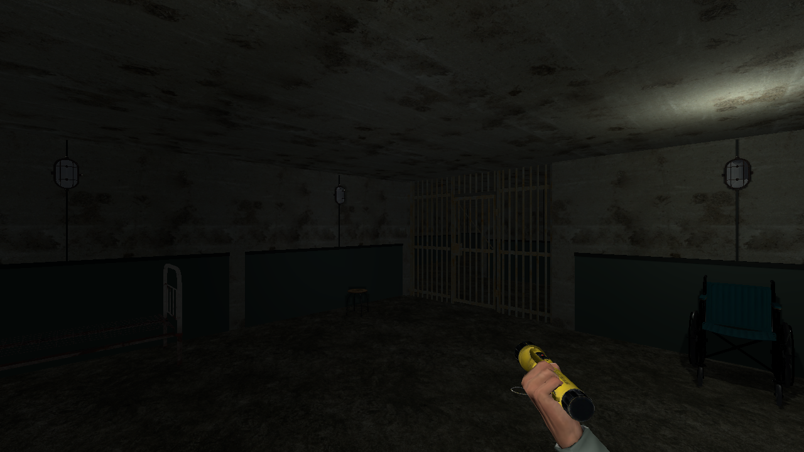
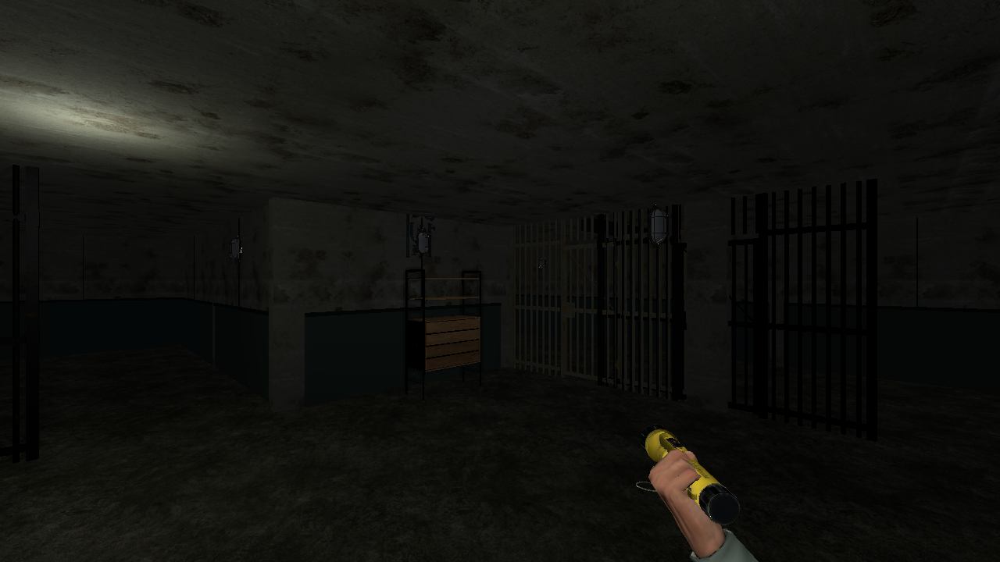

# 双生迷城 · Twin Labyrinth

**两个人，一束光，一起找到出口。**

Unity 3D 第一人称合作探索 · 双人联网 · 近战自卫测试版

[下载试玩包](https://github.com/bdjmcncfjbdjnc-bit/twin-labyrinth-unity/releases) · [运行指南](docs/GETTING-STARTED.md) · [测试记录](docs/TESTING.md) · [后续计划](docs/ROADMAP.md)

> 当前玩法版本：**coop-combat-20261124-r1**。上图为 Unity 相机的测试场景渲染；下方另列浏览器实机截图，没有用概念图代替游戏画面。
>
> **目前尚未实现两至三层地图。** 多层空间与“微恐、探索为主”的调整属于下一阶段方向。当前角色、手部与倒地动作仍有原型痕迹。

## 一起探索，一起离开

你和朋友被困在异常监区。探索牢房和功能房间，接通配电 A，再协作启动配电 B，最后共同到达出口。途中可从起点桌上领取刀具，观察囚犯行为，选择避开危险或近距离自卫；朋友倒地后可以靠近扶起。

本版本使用真正的 Unity 三维场景与 WebSocket 双人房间。原有 2.5D 浏览器游戏和 Unity 源码压缩包仍然保留，见 [旧版说明](docs/legacy-root-readme.md)。

## 目前可以体验

| 模块 | 当前实现 |
| --- | --- |
| 双人联机 | 创建房间、六位房间码和邀请地址；人物、手电、门与任务同步 |
| 监区探索 | 牢房、走廊、值班室、医务室、维修间、洗衣淋浴间、档案室与备品库 |
| 第一人称 | 移动、跑步、精力与喘息；可见手部、手电与刀具 |
| 囚犯行为 | 三名囚犯，每局一名普通、两名隐藏持刀；不通过外观标记身份 |
| 近战反馈 | 攻击、受击、侧倒、掉刀与声音反馈；误杀进入结算 |
| 合作救援 | 靠近倒地朋友持续按住 F；两人倒地则失败，不开放队友伤害 |
| 逃生流程 | A 供电 → 双人 B 供电 → 两人共同到达出口 |
| 重连 | 未过期房间恢复位置、物品和 NPC 状态；服务器重启不保留房间 |

狱警、五种随机协议、复杂 NPC 绕路、语音和长期存档目前没有启用。旧版功能不等于当前联机版已经实现的功能。

## 实机画面

以下四张为 **2026-11-24 公网双浏览器自动化测试**保存的原始截图，保留真实中文界面和画面亮度。

| 手电探索 | 第一人称持刀 |
| :---: | :---: |
|  |  |
| 交战后的倒地反馈 | 双人房间与中文前情 |
|  |  |

以下为 **Unity 相机离屏检查截图**：使用测试夹具设置视角，无 HUD，不作为真人通关证据。

| 医务室 | 值班区域 |
| :---: | :---: |
|  |  |

## 开始试玩

从 [Releases](https://github.com/bdjmcncfjbdjnc-bit/twin-labyrinth-unity/releases) 下载 WebGL + Node 服务端包，解压后按包内说明启动。使用电脑浏览器与键鼠；需要两名玩家连接，也可在本机两个独立浏览器会话中测试。

1. 一人创建房间，将六位房间码或邀请地址发给朋友。
2. 两人连接后分别点击「进入监区」。
3. 起点领取刀具，按屏幕目标一起恢复供电并寻找出口。

| 按键 | 功能 |
| --- | --- |
| WASD / 鼠标 | 移动 / 观察 |
| Shift | 跑步 |
| F | 拾取、开门、配电；靠近倒地朋友时按住救援 |
| 1 / 2 | 手电 / 刀 |
| L / 鼠标左键 | 手电开关 / 持刀攻击 |
| Esc | 自己的菜单，联机世界不会因此暂停 |

压缩主数据包约 **146 MiB**，首次加载可能较慢。以前的临时隧道不是长期托管地址，此仓库不把它作为稳定试玩服务。异地联机需要部署 HTTPS/WSS，详见 [运行指南](docs/GETTING-STARTED.md)。GitHub Pages 单独托管静态文件不能运行本项目的房间服务器。

## 工程与验证

- 引擎：Unity **6000.3.23f1**，URP **17.3.0**。
- 工程：[UnityURP](UnityURP)，联机场景：Assets/ArtReview/Coop/PrisonOnline.unity。
- 服务端：Node.js + 保留 MIT 许可的 ws；客户端 WebSocket 插件同步状态。
- 原版 main 与 demo/nightmare-prison-v2 分支保留，本次使用独立分支。

已有规则测试、三种身份分配的完整路线、真实网络救援与失败、完整双客户端网络回合（**8078 帧，439.1 秒**），以及本地和公网双 WebGL 的拾刀、移动、攻击、死亡同步、手电与刷新恢复。它们是自动化验证，**不是两名真人异地整局验收**。摘要见 [测试记录](docs/TESTING.md)。

## 下一阶段

1. 按两至三层规划监区，先完成两层可玩空间、楼梯和上下层视线。
2. 调整为微恐节奏：可辨通路、有限追逐、安静区域与克制的声音提示。
3. 改善第一人称手部、第三人称握持、受击与倒地动画。
4. 补充房间细节、压缩首包并完善异地联机体验。

这些是待实现事项，详见 [路线图](docs/ROADMAP.md)。

## 素材与许可

模型、声音、字体和第三方代码各自遵循对应许可，不能把整个仓库视为全部 CC0。来源包括 Poly Haven、Microsoft Rocketbox、CC0 人物输出、Valve 手势及 Noto 字体。

见 [素材来源与许可](docs/ASSETS.md)、[第三方声明](UnityURP/ThirdPartyNotices.txt) 与素材目录内的原始记录。本次未加入付费资产包、登录凭据、Unity 缓存或个人浏览器数据。
